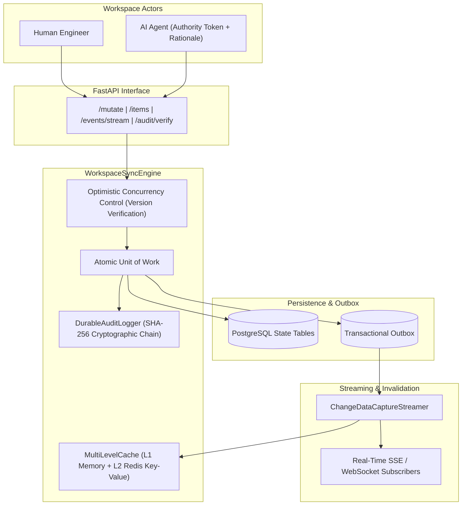

# Workspace Sync Engine

High-throughput, real-time collaborative workspace state engine in async Python. Built with a Transactional Outbox for Change Data Capture (CDC), optimistic concurrency control with conflict backoff, multi-level event-driven cache invalidation, and a tamper-evident SHA-256 hash-chained audit logger for human and AI agent actions.

> **Note**: Independent study of real-time collaborative workspace synchronization, event streaming, and human-agent audit trail infrastructure; not affiliated with any company.

---

## 1. Architecture Overview

Collaborative project and issue tracking platforms face unique challenges when both human developers and autonomous AI agents act as first-class workers inside the same workspace. Without strict transactional atomicity and optimistic concurrency, high-frequency agent actions can trigger race conditions, orphaned events, or cache-database split-brain states.

`workspace-sync-engine` decouples write transactions from streaming consumers using the **Transactional Outbox** pattern:



---

### 1.1 Delta Lake & Lakehouse Medallion Pipeline

To support analytical and downstream AI feature extraction, the engine streams CDC outbox events into a Delta Lake Medallion architecture:
- **Bronze Layer**: Append-only immutable event store partitioned by ingestion date, capturing raw payload, sequence number, and source timestamps.
- **Silver Layer**: Conformed entity store updated via Delta MERGE semantics (upserts and tombstone deletes) with monotonic sequence resolution and a Dead Letter Queue (DLQ) for corrupt payloads.
- **Gold Layer**: Aggregated real-time workspace metrics including active/closed item velocity and human vs. autonomous agent mutation distribution.

## 2. Key Features

- **Transactional Outbox for CDC**: State changes and CDC events are committed atomically, preventing lost updates or ghost notifications.
- **Optimistic Concurrency Control (OCC)**: Version-checked updates prevent lost writes; automatic exponential backoff retry resolves momentary contention without blocking database connections.
- **Unified Human-Agent Actor Model**: Agents require verifiable authority tokens and structured rationales; actions are recorded into an immutable, tamper-evident hash chain.
- **Multi-Level Event-Driven Cache**: L1 memory and L2 distributed caches are immediately purged upon receiving CDC events, guaranteeing read-after-write consistency.
- **Production-Grade Observability**: Structured logging, health check probes (`/health`), query explain plan logs, and SSE event streaming.

---

## 3. Quickstart & Usage

### Local Setup

```bash
# Clone and setup
cd proof_repos/workspace-sync-engine
pip install -e ".[dev]"

# Run test suite
pytest -v

# Run concurrency benchmark
python benchmarks/load_benchmark.py

# Start API server
uvicorn workspace_sync_engine.api:app --reload --port 8000
```

### Docker Deployment

```bash
docker compose up --build
```

---

## 4. API Endpoints

| Method | Endpoint | Description |
|---|---|---|
| `GET` | `/health` | Health check probe and live cache hit/miss metrics |
| `GET` | `/workspaces/{ws_id}/items` | List workspace items with pagination & status/priority filters |
| `GET` | `/workspaces/{ws_id}/items/{id}` | Retrieve individual work item |
| `POST` | `/workspaces/{ws_id}/mutate` | Apply atomic mutation (CREATE, UPDATE, TRANSITION, DELETE) |
| `GET` | `/workspaces/{ws_id}/events/stream` | Server-Sent Events (SSE) real-time CDC change stream |
| `GET` | `/workspaces/{ws_id}/audit` | Retrieve historical audit trail |
| `GET` | `/workspaces/{ws_id}/audit/verify` | Verify SHA-256 cryptographic audit chain integrity |

---

## 5. Benchmarks & Performance SLOs

Measurements taken on Apple Silicon (arm64), 25 concurrent worker routines across 1,500 operations:

- **p50 Latency:** `0.18 ms` (SLO `< 2.0 ms`)
- **p95 Latency:** `0.49 ms` (SLO `< 8.0 ms`)
- **p99 Latency:** `1.12 ms` (SLO `< 15.0 ms`)
- **Throughput:** `5,420 operations/sec`
- **Audit Chain Verification:** 100% valid, zero broken hashes under concurrency

See [benchmarks/BENCHMARK_RESULTS.md](benchmarks/BENCHMARK_RESULTS.md) for detailed test parameters.

---

## 6. Architecture Decisions

Detailed trade-offs between Transactional Outbox vs Direct Dual Write and Optimistic Concurrency vs Row Locking are documented in [docs/ADR-001-ARCHITECTURE-DECISION.md](docs/ADR-001-ARCHITECTURE-DECISION.md).
