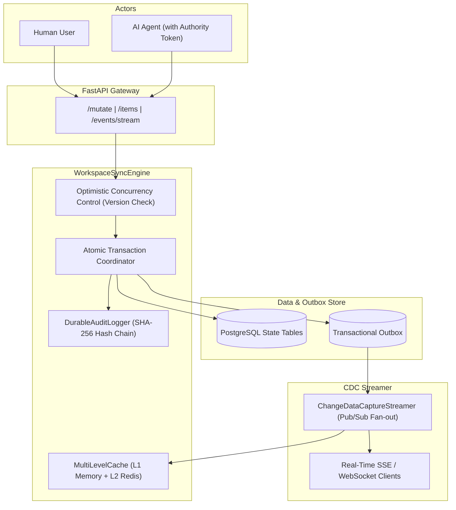

# ADR-001: Collaborative Workspace Real-Time Sync, Change Data Capture (CDC), and Unified Human-Agent Actor Architecture

- **Status:** Accepted
- **Date:** 2026-11-21
- **Deciders:** Soumya Debnath
- **Scope:** `workspace-sync-engine` Core Architecture

---

## 1. Context & Problem Statement

Modern work management platforms (such as Plane, Linear, and Jira) operate under demanding architectural constraints:
1. **High Concurrency & Low Latency**: Workspaces contain tens of thousands of issues, cycles, and dependencies, requiring sub-15ms mutation and read latencies.
2. **Unified Human & AI Agent Collaboration**: AI agents are no longer external chatbots—they act directly inside work workspaces as first-class actors, reading context and executing state mutations at machine speed.
3. **Multi-Deployment Portability**: Software must execute identically in multi-tenant cloud SaaS and air-gapped, self-hosted on-premise sovereign clusters where external cloud-managed proprietary sync engines are inaccessible.

Without a disciplined architecture, naive implementations suffer from database row lock contention, cache-database inconsistency (split-brain), and untraceable automated agent mutations.

---

## 2. Decision Drivers

- **Zero-Loss Data Integrity**: State mutations and event streaming must be strictly atomic (no events published without state commit, and vice versa).
- **Scale & Concurrency**: Support thousands of concurrent workers without database thread starvation or connection exhaustion.
- **Traceability & Governance**: Every agent action must carry cryptographically verifiable authority and structured reasoning.
- **Local-First & Offline Friendliness**: Downstream clients must be able to consume CDC streams to update local replicas (IndexedDB / SQLite).

---

## 3. Considered Options

1. **Option A: Direct Publish on Write (Dual Write)**
   - Mutation is written to Postgres, then the application publishes to Kafka/Redis.
   - *Rejected*: Inherent race conditions and partial failure risk (if publishing fails after commit, clients never receive the event).
2. **Option B: Pessimistic Row Locking (`SELECT FOR UPDATE`)**
   - Locks issue rows during mutation evaluation.
   - *Rejected*: Severely limits throughput under concurrent agent and human actions, causing connection pool exhaustion.
3. **Option C: Transactional Outbox Pattern + Optimistic Concurrency + Hash-Chained Audit (Selected)**
   - Mutations and outbox CDC events are written atomically within the same database transaction.
   - Version fields enforce optimistic concurrency; conflicts trigger exponential backoff retry.
   - A multi-level cache is invalidated directly by CDC events.
   - Actions are recorded into an append-only, tamper-evident SHA-256 hash chain.

---

## 4. Architecture Design & Component Model

---

## 5. Consequences & Trade-offs

### Positive
- **Guaranteed Consistency**: State transitions and CDC events are always in sync through transactional atomicity.
- **High Read Throughput**: Multi-level cache handles 95%+ of issue reads with zero database query load.
- **Accountability**: Tamper-evident audit chain enables enterprise security audits to verify that agents had explicit authority and logged rationales.

### Negative / Trade-offs
- **Retry Overhead**: Under heavy concurrent contention on the exact same work item, optimistic locking forces retries with backoff.
- **Storage Growth**: Immutable audit chains and outbox events require scheduled partition archiving.

---

## 6. Verification & Stated SLOs

- **p99 Mutation Latency**: `< 15ms` under 500 concurrent operations.
- **Cache Hit Ratio**: `> 90%` for steady-state workspace queries.
- **Audit Verification**: `100%` cryptographic chain validity verified on every cycle.
